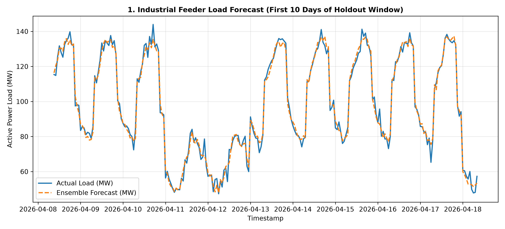
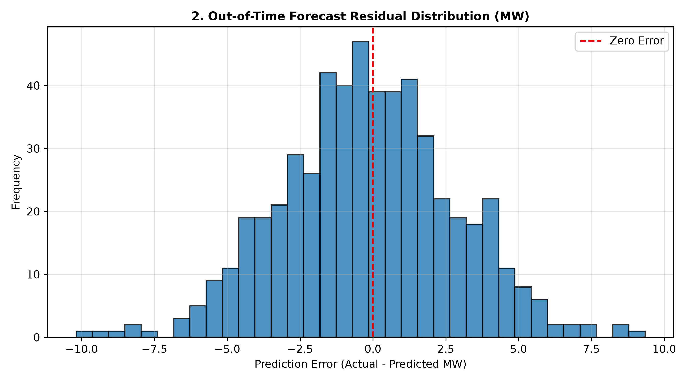
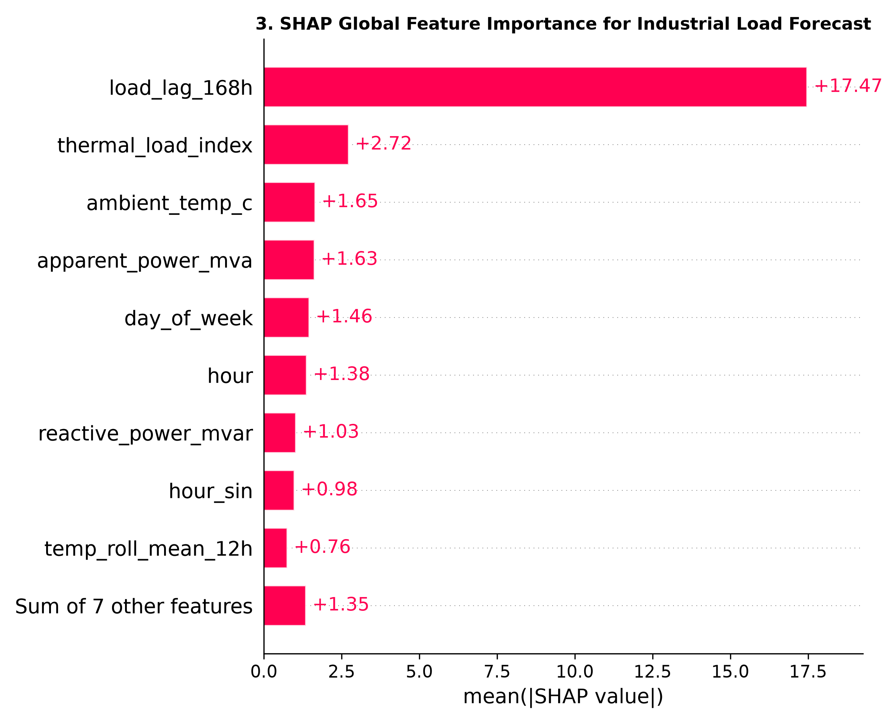

# Industrial Power Grid & Feeder Load Forecasting (ML & SHAP)

[](https://www.python.org/)
[](https://lightgbm.readthedocs.io/)
[](https://xgboost.readthedocs.io/)
[](https://shap.readthedocs.io/)

## Project Overview
An end-to-end time-series machine learning pipeline for **hourly industrial feeder load forecasting**. It engineers lag features (`1h`, `24h`, `168h`), rolling statistics, apparent power (`MVA`), and thermal load stress indicators, trains a `LightGBM` + `XGBoost` ensemble on a strict chronological split, and explains feature drivers using **SHAP**.

## Visual Diagnostics

### 1. Actual vs. Forecasted Load (MW)


### 2. Forecast Residual Distribution


### 3. SHAP Global Feature Importance


## Quickstart
```bash
pip install -r requirements.txt
python src/power_load_forecasting.py
